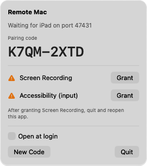
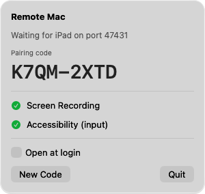
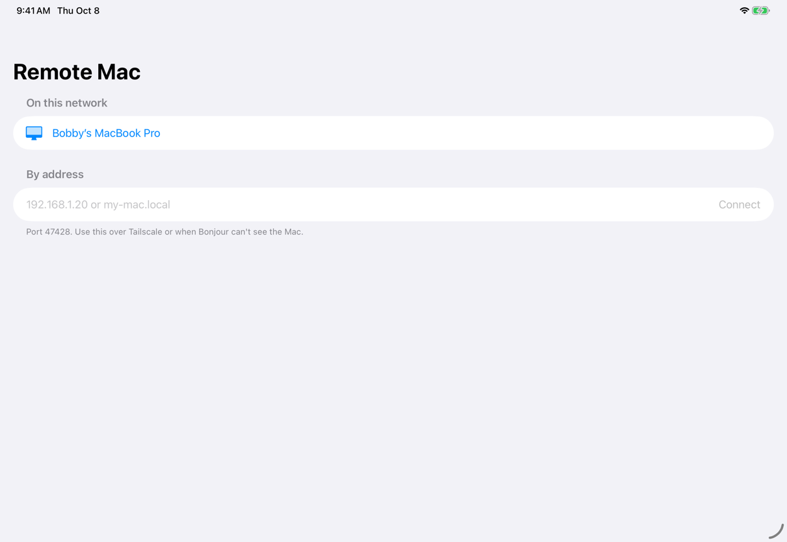
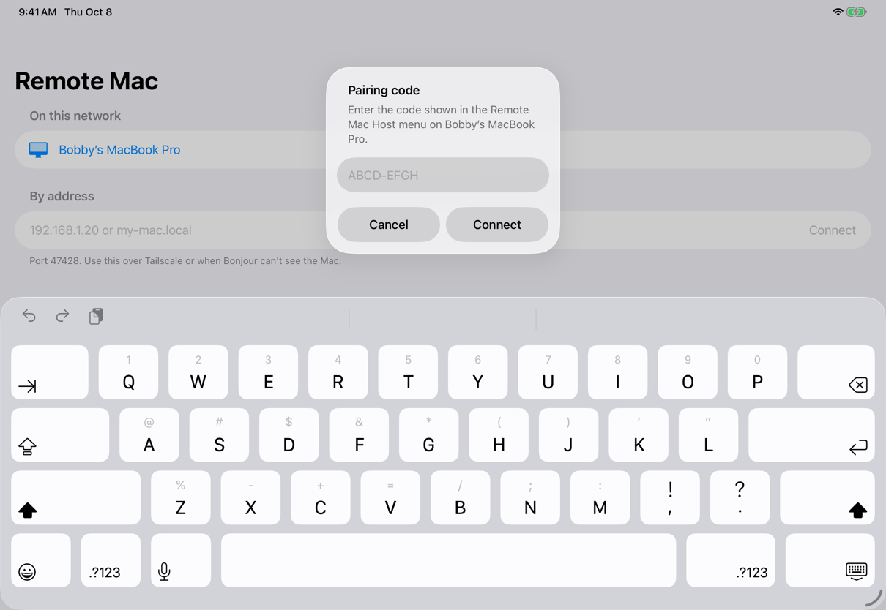

# Remote Mac

Use your iPad as a screen, trackpad and keyboard for your Mac, over your home
Wi-Fi. You see the Mac's full display on the iPad, with sound, and you control
it with touch, an iPad trackpad or mouse, or a keyboard.

There are two apps:

- **Remote Mac Host** runs on the Mac. It lives in the menu bar (the strip of
  icons at the top right of the screen), sends the screen to the iPad, and does
  what the iPad tells it.
- **Remote Mac** runs on the iPad. It finds your Mac on the network and shows
  its screen.

Neither app is on the App Store. You build both yourself, on your own Mac, from
the files in this repository. That sounds harder than it is: you copy and paste
about ten commands, and the rest is clicking. You do **not** need a paid Apple
developer account. A normal free Apple ID is enough.

The one catch with a free Apple ID: Apple only lets an iPad app you installed
yourself run for **7 days**. After that it stops opening until you reinstall
it, which takes about a minute ([Every 7 days](#every-7-days-refresh-the-ipad-app)
below). Your settings survive the reinstall.

---

**Contents**

- [What you need](#what-you-need)
- [Part 1. Install the tools on your Mac](#part-1-install-the-tools-on-your-mac)
- [Part 2. Download this project](#part-2-download-this-project)
- [Part 3. Install the Mac app](#part-3-install-the-mac-app)
- [Part 4. Put the app on your iPad](#part-4-put-the-app-on-your-ipad)
- [Part 5. Connect](#part-5-connect)
- [Every 7 days: refresh the iPad app](#every-7-days-refresh-the-ipad-app)
- [Using it away from home](#using-it-away-from-home)
- [Troubleshooting](#troubleshooting)
- [Updating to a newer version](#updating-to-a-newer-version)
- [Uninstalling](#uninstalling)
- [Controls](#controls)
- [For developers](#for-developers)
- [What does not work / not done](#what-does-not-work--not-done)

---

## What you need

- **A Mac running macOS 14 (Sonoma) or newer.** To check: Apple menu  ›
  About This Mac.
- **An iPad running iPadOS 17 or newer.** To check: Settings › General ›
  About. One with an M-series chip works best. See
  [What does not work](#what-does-not-work--not-done) for older iPads.
- **A USB cable** that connects the iPad to the Mac. You need it once per week
  at most, and possibly only once.
- **An Apple ID** (the account you use for the App Store). It must be one that
  has been signed in on an iPhone or iPad before; brand-new Apple IDs are often
  refused for this.
- **About 40 GB of free disk space** on the Mac, mostly for Xcode, and an hour
  for the first setup. Most of that hour is waiting for downloads.
- Both devices on **the same Wi-Fi network**.

## Part 1. Install the tools on your Mac

You'll use three things: **Terminal**, to type commands; **Xcode**, Apple's free
app for building apps; and **XcodeGen**, a small helper this project uses.

### Open Terminal

Press ⌘ Space, type `Terminal`, press Return. A window with a text prompt
opens. Every grey box in this guide that starts with a command is meant to be
pasted into this window, followed by Return.

Some commands ask for your **Mac's login password**. When you type it, nothing
appears on screen, not even dots. That's normal. Type it and press Return.

Leave Terminal open; you'll use it throughout.

### Install Xcode

1. Open the **App Store** on your Mac, search for **Xcode**, and click **Get**
   (then **Install**). It's free and large, several gigabytes, so this can take
   a while.
2. When it finishes, open Xcode once from your Applications folder. If it asks
   to install additional components, click **Install** and enter your Mac
   password. If it shows a window asking which platforms you want, you can just
   continue; the iPad part this project needs already comes with Xcode, and
   you don't need any simulators.
3. Quit Xcode (⌘Q). You won't need to open it again.
4. In Terminal, run these two commands. They tell your Mac's command line to
   use the full Xcode and accept its license.

   ```sh
   sudo xcode-select -s /Applications/Xcode.app/Contents/Developer
   sudo xcodebuild -license accept
   ```

### Install Homebrew and XcodeGen

[Homebrew](https://brew.sh) is the standard way to install command-line tools
on a Mac. Paste this into Terminal:

```sh
/bin/bash -c "$(curl -fsSL https://raw.githubusercontent.com/Homebrew/install/HEAD/install.sh)"
```

It asks for your password and then to press Return to continue. When it
finishes, **read the end of its output**. It prints a section called
**Next steps** with two or three lines to copy and run (they start with
`echo` and `eval`). Run them. If you skip this, the next command says
`command not found: brew`.

Then:

```sh
brew install xcodegen
```

To check everything is in place:

```sh
xcodegen --version && xcodebuild -version
```

You should see two version numbers, something like `Version: 2.44.1` and
`Xcode 26.6`. If you see an error instead, look at
[Troubleshooting](#troubleshooting).

## Part 2. Download this project

In Terminal:

```sh
cd ~
git clone https://github.com/notactuallytreyanastasio/padmac.git
cd padmac
```

This makes a folder called `padmac` in your home folder. **Every command from
here on must be run from inside it.** If you close Terminal and come back
later, run `cd ~/padmac` first.

## Part 3. Install the Mac app

### Build and install it

```sh
./scripts/install-host.sh
```

This takes a minute or two. You'll probably see:

```
Couldn't sign with the project's developer team; signing locally instead.
** BUILD SUCCEEDED **
Running. Click the display icon in the menu bar for the pairing code and permissions.
```

That first line is expected. The project is set up for its author's Apple
developer account, which your Mac doesn't have, so the script signs the app
for your Mac alone instead. That's all a Mac needs to run an app you built
yourself.

The app is now in your Applications folder as **Remote Mac Host** and is
running.

### Give it permission to see the screen and control the Mac

macOS won't let any app record the screen or move the mouse until you say so.

1. Click the **display icon** (a small monitor) in the menu bar at the top
   right of your screen. If you have many menu bar icons it may be hidden
   behind the camera notch; quit another menu bar app or hold ⌘ and drag icons
   to make room. A panel opens:

   

2. Click **Grant** next to **Screen Recording**. macOS shows a message; click
   **Open System Settings**. In the list under **Screen & System Audio
   Recording**, turn on **Remote Mac Host**. Enter your password if asked.
3. Click the display icon again, then **Grant** next to **Accessibility
   (input)**. Again choose **Open System Settings**, and turn on **Remote Mac
   Host** under **Accessibility**.
4. **Quit and reopen the app.** macOS only applies Screen Recording when an app
   starts. Click the display icon, click **Quit**, then open **Remote Mac
   Host** from your Applications folder (or press ⌘ Space, type `Remote Mac
   Host`, Return). If System Settings offered a **Quit & Reopen** button, that
   does the same thing.
5. macOS may also ask whether Remote Mac Host may **find devices on your local
   network**, and, if your firewall is on, whether it may **accept incoming
   network connections**. Click **Allow** for both. Without them the iPad
   can't reach the Mac.

When it's ready, the panel shows two green checkmarks:



The big code (`K7QM-2XTD` here; yours is different) is your **pairing code**.
The iPad needs it once. Anyone who has it and is on your network can control
your Mac, so treat it like a password. **New Code** makes a fresh one and
disconnects anything using the old one. The status line reads
`Waiting for iPad on port 47428` on your Mac (the screenshot came from a test
copy on a different port).

### Keep it running (recommended)

So the host starts when you log in and comes back if it ever crashes:

```sh
./scripts/keepalive-host.sh
```

After this, the **Quit** button restarts the host instead of stopping it. To
turn this off: `./scripts/keepalive-host.sh --remove`.

## Part 4. Put the app on your iPad

Apple only lets you install apps outside the App Store if they are signed with
your Apple ID, and only for 7 days at a time with a free account. A free tool
called **Sideloadly** does the signing and installing for you.

### Build the iPad app

In Terminal, in the `padmac` folder:

```sh
./scripts/build-ipa.sh
```

When it's done it prints something like:

```
** BUILD SUCCEEDED **
Wrote /Users/you/padmac/RemoteMac.ipa (bundle ID io.github.remotemac.ipad-5ca80be5)
```

`RemoteMac.ipa` is the iPad app, packed into one file. The bundle ID is the
app's name as far as Apple is concerned. The script makes one that's unique to
your Mac, because Apple won't let two different people's accounts use the same
one, and keeps it the same every time you rebuild. To find the file in Finder:

```sh
open -R RemoteMac.ipa
```

### Install Sideloadly

1. Download it from [sideloadly.io](https://sideloadly.io) (the **macOS**
   download).
2. Open the downloaded file and drag Sideloadly into Applications, then open
   it. If macOS says it can't check the app for malicious software, go to
   System Settings › Privacy & Security, scroll down, and click **Open
   Anyway**.

Sideloadly asks for your Apple ID and password, because it signs the app as
you, the same way Xcode would. It sends them only to Apple. If you'd rather not
type your main password into a third-party app, that's a reasonable choice;
see [Installing with Xcode instead](#installing-with-xcode-instead).

### Connect the iPad

1. Plug the iPad into the Mac with the cable and unlock it.
2. If the iPad asks **Trust This Computer?**, tap **Trust** and enter the iPad
   passcode.
3. Sideloadly should now show your iPad in its **iDevice** dropdown.

### Sideload the app

1. Drag `RemoteMac.ipa` onto the Sideloadly window (or click the IPA icon and
   pick it).
2. Type your Apple ID email in the **Apple account** box.
3. Click **Start**. Enter your Apple ID password when asked, and, if you have
   two-factor authentication, the 6-digit code that appears on your other
   devices.
4. Wait for **Done.** at the bottom of the window.

If Sideloadly says an App ID **is not available**, the bundle ID is already
taken by some other account. Run the build again with a name of your own, then
sideload the new file:

```sh
REMOTEMAC_BUNDLE_ID=com.yourname.remotemac ./scripts/build-ipa.sh
```

Use only letters, digits, dots and hyphens. Use the same command every time
you rebuild after that.

### Turn on Developer Mode (iPadOS 16 and later)

The first time you sideload anything, the iPad needs Developer Mode. The
setting only appears after an app like this has been installed.

1. On the iPad: Settings › **Privacy & Security** › scroll to the bottom ›
   **Developer Mode** › turn it on.
2. Tap **Restart**. After the iPad restarts and you unlock it, tap **Turn On**
   and enter your passcode.

### Trust your Apple ID on the iPad

1. Settings › General › **VPN & Device Management**.
2. Under **Developer App**, tap your Apple ID email.
3. Tap **Trust "your email"**, then **Trust**.

If you skip this, tapping the app shows **Untrusted Developer**.

## Part 5. Connect

1. Make sure the iPad is on the same Wi-Fi as the Mac.
2. Open **Remote Mac** on the iPad.
3. The first time, it asks to **find and connect to devices on your local
   network**. Tap **Allow**. If you tapped Don't Allow, fix it in Settings ›
   Privacy & Security › Local Network › Remote Mac.
4. Your Mac appears under **On this network**. Tap it.

   

5. Type the pairing code from the Mac's menu bar panel. Capitals and the dash
   don't matter. Tap **Connect**.

   

The Mac's screen appears. The iPad remembers the code, so next time you just
tap the Mac. If the screen stays black or it says it can't connect, see
[Troubleshooting](#troubleshooting).

By default a finger on the screen works like a laptop trackpad: drag to move
the pointer, tap to click. The full list is under [Controls](#controls).

## Every 7 days: refresh the iPad app

With a free Apple ID, the app stops opening 7 days after it was installed.
To renew it, repeat **Sideload the app** from Part 4: plug in,
drag `RemoteMac.ipa` onto Sideloadly, **Start**. You don't need to rebuild,
redo Developer Mode, or re-enter the pairing code.

To have this happen on its own, Sideloadly can refresh apps in the background
over Wi-Fi, as long as the Mac is on and Sideloadly is running:

1. With the iPad plugged in, open **Finder**, click the iPad in the sidebar,
   and tick **Show this iPad when on Wi-Fi**. Click **Apply**.
2. In Sideloadly, enable automatic refresh for the app (right-click the app in
   Sideloadly's list of installed apps; the exact menu wording varies by
   Sideloadly version).

Other free Apple ID limits worth knowing: at most 3 sideloaded apps at once
on a device, and a limited number of new bundle IDs per week. Reinstalling
this app with the same bundle ID doesn't use up either.

## Using it away from home

Remote Mac is meant for your own network. Do **not** open port 47428 on your
router to the internet: the pairing code is short enough that someone who
records a connection attempt could crack it offline.

To use it from elsewhere, install [Tailscale](https://tailscale.com) (free for
personal use) on both the Mac and the iPad and sign in to the same account on
both. Then, in the iPad app, type the Mac's Tailscale name or its `100.x.x.x`
address into **By address** and tap **Connect**. The Mac won't show up under
**On this network** over Tailscale; that list only sees the local Wi-Fi.

## Troubleshooting

**`command not found: brew`** — you skipped Homebrew's "Next steps". On Apple
silicon Macs, run:

```sh
echo 'eval "$(/opt/homebrew/bin/brew shellenv)"' >> ~/.zprofile
eval "$(/opt/homebrew/bin/brew shellenv)"
```

**`xcode-select: error: tool 'xcodebuild' requires Xcode, but active developer
directory ... is a command line tools instance`** — run
`sudo xcode-select -s /Applications/Xcode.app/Contents/Developer`.

**`You have not agreed to the Xcode license agreements`** — run
`sudo xcodebuild -license accept`.

**`no such file or directory: ./scripts/...`** — you're not in the project
folder. Run `cd ~/padmac`.

**The display icon isn't in the menu bar.** It may be hidden behind the camera
notch. Quit another menu bar app to make room, or check it's running: press
⌘ Space, type `Remote Mac Host`, Return.

**The Screen Recording checkmark stays orange after turning it on.** Quit
Remote Mac Host from its panel and open it again.

**The iPad doesn't list my Mac.**
- Both devices on the same Wi-Fi network? Guest networks and some office or
  hotel networks block devices from seeing each other.
- On the iPad: Settings › Privacy & Security › Local Network › **Remote Mac**
  must be on.
- On the Mac: System Settings › Privacy & Security › Local Network ›
  **Remote Mac Host** must be on (macOS 15 and later).
- Try **By address** instead: on the Mac, open System Settings › Wi-Fi ›
  Details next to your network to see its IP address (like `192.168.1.20`),
  and type that.

**"Couldn't connect" or it keeps saying "Reconnecting".** Check the Mac's
firewall isn't blocking it: System Settings › Network › Firewall › Options,
and make sure Remote Mac Host is set to allow incoming connections.

**It rejects the pairing code.** Check it against the Mac's menu bar panel.
If someone pressed **New Code**, the iPad's saved code is stale: tap **Back**
on the error, then tap the Mac again and enter the new code.

**The picture is black but the pointer moves.** Screen Recording isn't
granted, or the app wasn't reopened after granting it. On older iPads, try the
**Data saver** quality setting (the gauge button on the iPad toolbar).

**Clicks and typing do nothing, but I can see the screen.** Accessibility isn't
granted. Check the checkmark in the menu bar panel.

**The iPad app won't open, or it says "Untrusted Developer"** — do
[Trust your Apple ID on the iPad](#trust-your-apple-id-on-the-ipad).

**The iPad app opened yesterday and won't open today.** The 7 days are up.
[Refresh it](#every-7-days-refresh-the-ipad-app).

**Sideloadly doesn't see the iPad.** Unlock the iPad, unplug and replug, tap
**Trust** if asked. Try a different cable; some charge-only cables carry no
data.

**Sideloadly: "Your maximum App ID limit has been reached."** Free accounts
can only create a few new bundle IDs per week. Wait a few days, and keep using
the same bundle ID once one works.

## Updating to a newer version

```sh
cd ~/padmac
git pull
./scripts/install-host.sh
./scripts/build-ipa.sh
```

Then sideload the new `RemoteMac.ipa` as in Part 4.

One thing to expect: because the Mac app is signed for your Mac only, macOS
sees each rebuild as a slightly different app and **forgets its Screen
Recording and Accessibility permissions**. After updating, open the menu bar
panel and grant both again, as in Part 3. If System Settings already shows
Remote Mac Host switched on but the panel says otherwise, select it in the
list, remove it with the **−** button, and click **Grant** again.

## Uninstalling

On the Mac:

```sh
cd ~/padmac
./scripts/keepalive-host.sh --remove
rm -rf "/Applications/Remote Mac Host.app"
cd ~ && rm -rf ~/padmac
```

Then remove Remote Mac Host from System Settings › Privacy & Security ›
Screen & System Audio Recording and › Accessibility. On the iPad, delete the
app like any other. You can turn Developer Mode back off in Settings › Privacy
& Security.

---

## Controls

| Input | Trackpad mode (default) | Direct mode |
|---|---|---|
| 1-finger drag | move cursor (relative, accelerated) | drag with button held |
| tap | click (double-tap = double-click) | click there |
| 2-finger tap | right-click | right-click there |
| 2-finger drag | scroll | scroll |
| touch, hold, drag | drag | — |
| pinch | zoom (1–8×); move the pinch to pan | same |
| 3-finger swipe left/right | next/previous desktop, following your fingers like a Mac trackpad | same |
| 3-finger swipe up/down | Mission Control / App Exposé | same |

While zoomed, the view follows the Mac cursor. The toolbar's magnifier toggles
between the whole display and filling the iPad's short side, which is the
useful zoom for an ultrawide. A display button appears when the Mac has more
than one active display.

Sound: the Mac's audio plays on the iPad (16-bit 48 kHz stereo, about 1.5
Mbit/s, ~60 ms behind). The speaker button turns it off, and the choice is
remembered. The Mac keeps playing through its own speakers too.

Clipboard: text and images copied on the Mac show up on the iPad right away.
If both are there, the image wins. Images over 16 MB are skipped. Anything
a password manager marks as concealed stays on the Mac. Going the other way,
the toolbar's paste button puts the iPad clipboard (text or image) on the Mac
and presses ⌘V. It's a system paste control, so iPadOS doesn't ask
permission each time.

Quality: the gauge button picks **Full** (native, up to 40 Mbit/s, 60 fps),
**Balanced** (2560 wide, 8 Mbit/s, 60 fps) or **Data saver** (1920 wide,
2.5 Mbit/s, 30 fps). It switches without reconnecting, and the menu shows
what the link is carrying right now. Audio adds 1.5 Mbit/s; turn it off on
a tight link.

An iPad trackpad or mouse maps absolutely: hover puts the Mac cursor under it,
click and right-click work, and two-finger scrolling scrolls. The iPad's own
pointer is hidden because the Mac's cursor is in the video.

A hardware keyboard sends real key codes, including modifiers and arrow and
function keys, with key repeat. iPadOS keeps ⌘Tab and ⌘Space for itself (no
app can capture them), so ⌥ stands in:

| On the iPad keyboard | On the Mac |
|---|---|
| ⌥Tab, keep holding ⌥, Tab / ⇧Tab, release ⌥ | ⌘Tab app switcher |
| ⌥` | ⌘` next window of the app |
| ⌥Space | ⌘Space Spotlight |

⌥ with any other key is passed through unchanged. If you press ⌘Tab out of
habit and iPadOS switches apps, Remote Mac reminds you when you come back. The on-screen keyboard (toolbar ⌨) types
literal text and has an accessory row: esc, tab, sticky ⌃⌥⌘⇧ and arrows.
Sticky modifiers apply to the next key, so ⌘ then `c` copies.

While an iPad is connected, the Mac's display is woken and kept from sleeping.
The menu bar panel shows who's connected and has a **Disconnect** button.

## For developers

### How it works

The host captures a display with ScreenCaptureKit and hardware-encodes it to
HEVC at native resolution, falling back to H.264 capped at 4096 px wide. It
injects the iPad's input with CGEvent and syncs the clipboard. The iPad app
finds hosts over Bonjour (`_remotemac._tcp`), decodes with
`AVSampleBufferDisplayLayer`, and reconnects on its own after being
backgrounded or losing Wi-Fi.

The link is TLS 1.2 with a pre-shared key derived from the 8-character pairing
code. There are no certificates and no accounts. A client without the code
fails the handshake (`-9820: bad MAC`).

### Signing

`project.yml` signs with the author's team (`NY422J2AAW`).
`scripts/install-host.sh` tries that first and falls back to an ad-hoc
signature when this Mac can't sign as that team. `scripts/build-ipa.sh` builds
unsigned, with a bundle ID derived from the Mac's hardware UUID (override with
`REMOTEMAC_BUNDLE_ID`), for Sideloadly or AltStore to re-sign.

### Installing with Xcode instead

With a paid developer account, put your team ID in `DEVELOPMENT_TEAM` in
`project.yml` and change the two `com.bgrayson.remotemac` bundle IDs, then plug
the iPad in, trust the Mac, enable Developer Mode, and run
`./scripts/install-ipad.sh`. Apps installed this way last a year instead of
7 days. A free Personal Team works the same way after signing in under Xcode ›
Settings › Accounts, with the 7-day limit; this path hasn't been tested with a
free team.

### Tests

```sh
./scripts/test.sh          # everything; leaves your cursor and clipboard alone
./scripts/test.sh --live   # also moves the real cursor and round-trips the clipboard
```

What runs:

| Layer | Where | What it proves |
|---|---|---|
| `RemoteMacTests` (52) | macOS | Wire format round-trips and rejects malformed input. Framing over a real TLS-PSK socket: 5 MB messages, wrong code rejected, unknown or oversized messages hang up, video backpressure. HEVC at 5120×1440 and H.264 encoded and decoded through the real pipeline. Input logic: double-click counting, ⌘ flags on ⌘C, key repeat, text chunking, the lost-delta bug. The iPad key map checked against macOS's real US layout. The host server in dry-run mode. The display staying awake only while an iPad is connected. |
| `RemoteMacClientTests` (14) | iPad simulator | Zoom/pan geometry (no gaps, the pinch anchor stays put, follow-the-cursor) and three-finger swipe axis locking. |
| `RemoteMacUITests` (10) | iPad simulator | The real app, with real taps, drags, pinches and keyboard keys, against a real host in `-dryRunInput` mode. Assertions are on the input the host received. |
| `probe` | macOS | Real screen capture → HEVC → TLS → decode, a stream restart, and median capture-to-decode latency under 50 ms (this Mac: ~18 ms idle, ~40 ms under heavy load). |

The UI tests need the simulator's on-screen keyboard (I/O › Keyboard ›
Connect Hardware Keyboard off). The host needs Screen Recording permission
for your terminal.

The probe also works on its own, against any host:

```sh
probe <host[:port]> <code> frame.png [--move] [--displays] [--clipboard] [--swipe] [--h264] [--latency]
```

To run a second host next to an installed one, launch its binary with
`-port 47429 -pairingCode TESTCODE`. Add `-dryRunInput YES -inputLog <path>`
and it logs input instead of posting it. `-traceLatency YES` logs where the
time goes between capture and the wire.

## What does not work / not done

- **Switching to a second display is untested.** The dev Mac had its lid
  closed, so only one display was active. Re-selecting the same display (the
  path a resolution change also takes) is tested.
- **Older iPads and 5120-wide HEVC.** The client asks for up to twice its own
  resolution, so an ultrawide streams at 5120×1440. M-series iPads decode that
  easily. An A12-era iPad may not. If the picture stays black, that's the
  first suspect; try **Data saver**.
- **Desktop swipes rely on undocumented Dock events.** The event layout is
  Mac Mouse Fix's, verified on macOS 26.2 (`probe --swipe` changes desktop and
  back and checks it through SkyLight). Mac Mouse Fix reports that macOS 27
  ignores these fields, so expect swipes to stop working there.
- **iPadOS keeps some shortcuts.** ⌘Tab and ⌘Space have ⌥ stand-ins (above).
  ⌘H, and Globe shortcuts, still go to the iPad.
- **Clipboard has no files**, only text and images.
- **The Mac still plays its own sound** while streaming it.
- **Two streams at once are slow.** While an iPad is connected, a second
  stream from the same Mac (the probe, in testing) measures ~125 ms
  capture-to-decode instead of 13–19 ms. One stream, the normal case, is
  unaffected. `test.sh` detects a live session and skips only the latency
  check, with a note. Why two real capture pipelines interfere is not known:
  two synthetic encoders side by side don't.
- **Locked-screen login is untested.** Typing your password at the lock
  screen from the iPad may be blocked by macOS secure input.
- **Local network only by design.** The 40-bit code resists online guessing,
  but a captured handshake could be brute-forced offline. Don't port-forward
  47428 to the internet. Use Tailscale or another VPN.
- **The Sideloadly steps were written from its documentation, not run end to
  end** on a fresh Apple ID. The ad-hoc host build (with signing as the
  author's team forced to fail) and the unsigned `.ipa` build were run.
- **Ad-hoc signed host loses its permissions on every rebuild**, as described
  under [Updating](#updating-to-a-newer-version). "Open at login" in the menu
  may also not work with an ad-hoc signature; `keepalive-host.sh` does.
- **Tested in the iOS Simulator and with the probe, not yet on a physical iPad.**
  Trackpad/mouse and hardware-keyboard paths especially need a real device.
